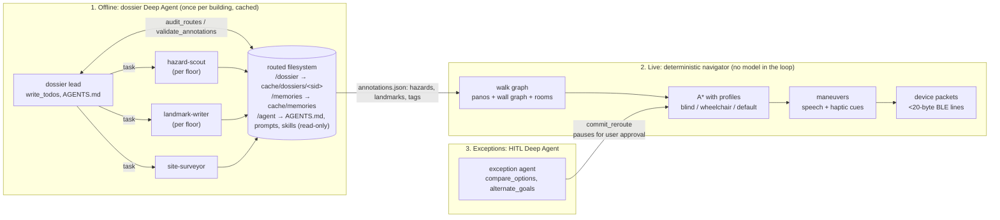

# Nudge

Indoor wayfinding for blind and low-vision visitors, built on CoStar Group's data for the same buildings: Matterport 3D twins, Vexcel aerial imagery and CoStar building records (Houston and Los Angeles).

**Thesis: put the AI ahead of the walk, not inside it.** Routing a person through a building is A* on a graph, and left versus right is trigonometry. That part is deterministic, takes milliseconds and can't hallucinate a turn into a stairwell. What the geometry can't tell you is what's dangerous, what can be felt or heard, and where the accessible entrance is. A Deep Agent works that out once per building, before anyone arrives, and caches it. The second visitor pays nothing.

## Architecture



1. **Offline dossier** (`nudge/agents/dossier.py`). The lead plans with `write_todos`, then delegates through `task()`:
   - `site-surveyor`: Vexcel aerial plus CoStar record, giving entrances, drop-off, parking and the suite directory.
   - `hazard-scout`, once per floor. The point cloud proposes candidates and `look()` at the panorama confirms them.
   - `landmark-writer`, once per floor: non-visual landmarks at the turn points the route audit flags.

   The lead merges everything into `/dossier/annotations.json`, validates it, runs a blind and a wheelchair route audit, re-delegates fixes (two rounds at most), and writes a briefing meant to be read aloud. Its identity is in `AGENTS.md` and its domain knowledge is in four skills: `hazard-taxonomy`, `nonvisual-landmarks`, `annotation-format` and `site-survey`. It records lessons across buildings in `/memories/lessons.md`, and a `FilesystemPermission` stops it writing to its own instructions under `/agent/`.
2. **Live navigation**:
   - `walkgraph.py` links scan positions that have line of sight through the wall graph, treating doors and openings as passable, and joins floors through stairs and elevator rooms.
   - `router.py` runs A* with accessibility profiles.
   - `instruct.py` turns the route into spoken maneuvers.
   - `navigator.py` tracks position, times the cues and reroutes when the user drifts.
   - `device.py` produces metre and degree packets for a haptic wearable.
3. **Exceptions** (`nudge/agents/exception.py`). When the plan breaks (an elevator is out, a door is locked), this Deep Agent compares options using only router output. The one tool that changes anything, `commit_reroute`, uses `interrupt_on`, so the traveller approves every reroute.

## Channels

- **Browser debug view** (`web/debug.html` + `nudge/server.py`): floor plan, walk graph, route, simulated walk with speech and `navigator.vibrate`. You can drag the walker off route to watch a reroute, or block an edge.
- **iMessage via Photon** (`nudge/photon_bot.py`, Photon Beta API):
  - "take me to the kitchen at <address>" returns the briefing and the first step.
  - "the elevator is out" makes the exception agent propose a reroute.
  - "yes" or "no" approves or rejects it.

  It suits VoiceOver users, who already live in Messages.
- **Haptic device line protocol** (`nudge/device.py`): `2,T,L,90,4.5` means turn left 90° after 4.5 m, and the live line `N,2.4,-15,TR,0` means 2.4 m to the next turn, steer 15° right. Every line is under 20 bytes, so one fits in a single BLE packet.

## How the data layers are used

| Layer | What Nudge takes from it |
|---|---|
| Matterport panoramas | `look()` renders a perspective view from any scan position in any model-frame direction. Subagents use it to confirm hazards and to describe floor material, handrails and wall ends. |
| Matterport wall graph + rooms | The walkable graph: line of sight between panos, doors and openings, room labels for destinations and for "into the lobby". |
| Matterport point cloud (MatterPak) | Candidates for protruding objects in the 27–80 in band with nothing below for a cane to hit (ADA 2010 §307.2). Glass suspects are walls with almost no point support. |
| Vexcel orthophoto | The site survey: entrances, curb ramps, drop-off, accessible parking, the approach from the street. |
| CoStar record | Year built (a prior for non-compliant features), floors, tenants and suites as destination aliases, parking. Joined by CoStar property id from `reference/models_index.csv`. |

## Track mapping

| Track | Where it shows |
|---|---|
| CoStar "Inside and Out" | **Data:** all three layers for the same address, and each one changes a route or a spoken instruction. **Agentic depth:** the agent plans, delegates, looks, validates against the router, audits and re-delegates. **Usefulness:** a blind visitor gets an accessible-entrance briefing and hazard-aware routes in a building they've never been to. **Demo:** debug view, iMessage, device packets. |
| LangChain Deep Agents | **Complex use case:** a multi-floor survey with vision and geometry. **Features used:** `create_deep_agent` with three subagents via `task()`, `TodoListMiddleware`, `CompositeBackend` routing `/dossier`, `/memories` and `/agent` to disk, `memory=["/agent/AGENTS.md"]`, `skills=["/agent/skills/"]`, `FilesystemPermission` read-only on `/agent`, and HITL `interrupt_on={"commit_reroute": True}` in the exception agent. `langgraph.json` serves both agents in Studio. |
| Photon | iMessage is the primary user interface, using Photon Beta's `list_messages`, `send_message` and typing indicator, with yes/no approvals in the thread. |
| Amazon Practical AI | A real user and problem, an agent that plans and acts, adaptive replanning, and an interface the user already has. |

## Quickstart

```bash
pip install -r requirements.txt
cp .env.example .env        # fill in keys from /costar-keys, OPENROUTER_API_KEY (free), PHOTON_*
python -m pytest -q -p no:anyio
```

No keys needed (synthetic two-floor building):

```bash
python -m nudge.cli synthetic --from K3 --to "Conference Room" --simulate
python -m nudge.cli synthetic --from K3 --to "Conference Room" --simulate --drift-at 10
python -m uvicorn nudge.server:app --port 8765   # then open http://localhost:8765/debug.html
```

Needs keys:

```bash
python -m nudge.probe                      # matterport key check + schema questions
python -m nudge.pick                       # rank buildings that join to costar
python -m nudge.cli MgGNVWsyXtH --alts     # real model: graph stats + routes per profile
python -m nudge.agents.dossier <sid>       # run the dossier agent (OPENROUTER_API_KEY, free); streams plan/delegations
python -m nudge.photon_bot                 # iMessage agent (PHOTON_PROJECT_ID, PHOTON_API_KEY)
langgraph dev                              # both agents in LangGraph Studio (NUDGE_SID, default synthetic)
```

The dossier agent and the synthetic `look()` / `overhang_candidates()` also run offline on `synthetic`, which is handy for wiring checks. There are no model credits at the hackathon, so the models default to OpenRouter's free tier, as LangChain's track guidance suggests: `nvidia/nemotron-3-ultra-550b-a55b:free` for the lead and text agents, and the vision model `nvidia/nemotron-3.5-super-vl:free` for the subagents that call `look()`. Override them with `NUDGE_MODEL` / `NUDGE_VISION_MODEL`; with `ANTHROPIC_API_KEY` set, everything uses `anthropic:claude-opus-5-5`.

## Limitations

- **Indoor localization isn't solved here.** The navigator takes positions in the model frame. In the demo they come from the twin (the simulated walk or the debug view), not from a phone. PDR drift and magnetometer error indoors are real; the realistic path is visual relocalization against the Matterport panoramas.
- **Panorama orientation is unverified.** `perceive.FACE1_YAW_DEG` (which model yaw skybox face 1 faces) and the per-pano rotation field are unverified until we have keys. `perceive.calibrate()` exists to set them.
- **Point-cloud thresholds are untested on real scans.** They were tuned on synthetic data. Expect tables near walkways to show up as overhang candidates; the agent confirms or rejects each one with `look()`.
- **Some Model API fields are guesses.** Edge `type` values for doors and openings, `panoLocations.floor` and `room` are not confirmed. `fetch.py` drops a rejected field and retries, and `walkgraph.py` falls back to splitting floors by z and to bridging disconnected pieces, with warnings.
- **iOS Safari has no Web Vibration API.** Use Android for the browser haptics, or the device protocol.
- **Photon Beta iMessage sends text and images only.** There are no tapbacks or voice notes on Beta.
