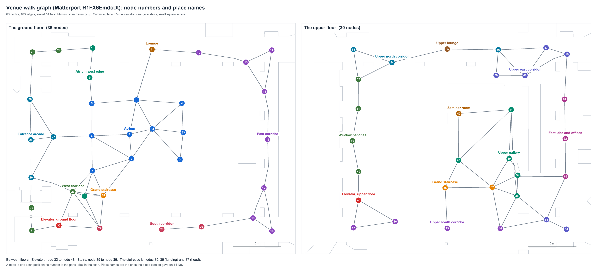
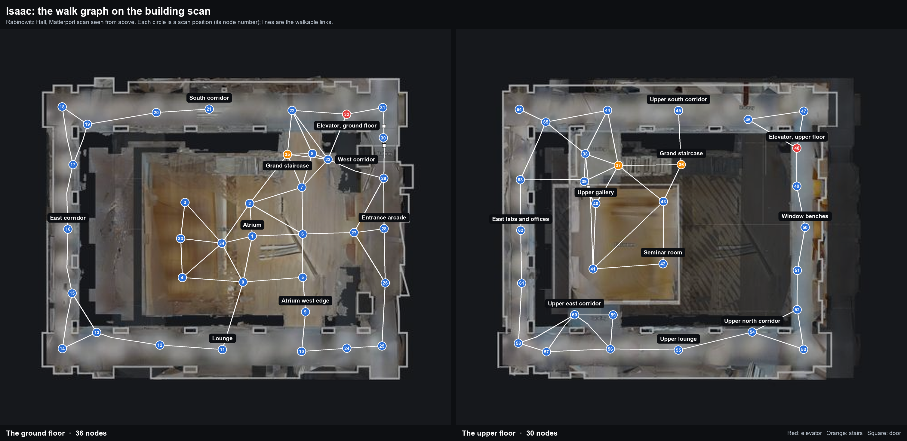

# Venue landmarks and their node numbers

The venue scan is Matterport model `R1FX6EmdcDt`. A **node** is one scan position (a Matterport pano). Its
**number** is the pano's label in the scan, and its **id** is the pano id, which is what the code uses:
`walkgraph.apply_annotations` and the place catalog both key on the id, not the number.

This list was written from a copy of the walk graph saved on 14 Nov (66 nodes, 103 edges).
Room names are the ones the place catalog gave at that time. If the scan or the catalog has been
rebuilt since, check a few numbers against `python tools/venue_route.py --list` before relying on it.

Positions are in metres in the scan's frame. The lower level has no nodes.

The same graph on the scan itself, seen from above (the scan's floor plan view is turned half a turn from
the drawing above, so the elevator is at the top right here):

Two interactive pages are in `web/`, so the server serves them: `/venue-paths.html` and `/venue-3d.html`
(for example `http://localhost:8765/venue-paths.html`). Each is one file with everything inside and also
opens by double-click, with no network.

- `web/venue-paths.html`: pick two places and it draws the shortest route on the scan with its turns;
  "Snap photo" saves a PNG.
- `web/venue-3d.html`: both floors stacked, each floored with the top-down scan capture, with a route
  picker, an exploded view and "Save PNG". The floors are flat captures of the scan, not its 3D mesh.

Their routes are the shortest by edge length; they are not taken from `nudge/router.py`.

## Landmarks

The **Identify by** column is for what a blind traveller can tell without sight: what is underfoot, a
sound, what a hand or cane meets. Only the staircase has that so far; the rest are left empty to fill in.

| Landmark | Node | Node id | Floor | x, y (m) | Identify by |
|---|---|---|---|---|---|
| Elevator, ground floor | 32 | `w5kacr4ci0d92c5wkzrfs4erd` | the ground floor | -8.0, -13.0 |  |
| Elevator, upper floor | 48 | `9f45hxprghib9bgxnzkd87f6b` | the upper floor | -7.6, -10.4 |  |
| Grand staircase, foot | 35 | `36aa2eubht8idy9kr2k8aubac` | the ground floor | -3.4, -9.9 | grand staircase with glass railings and a handrail on both sides (already in the graph) |
| Grand staircase, landing part way up | 36 | `b8ckm0ge7yzdxbq0f5tkeswyd` | the upper floor | 1.4, -9.1 | grand staircase with glass railings and a handrail on both sides (already in the graph) |
| Grand staircase, head (in the upper gallery) | 37 | `3xprhtpgyi8tqttrrqhmghw6b` | the upper floor | 6.3, -9.1 | grand staircase with glass railings and a handrail on both sides (already in the graph) |
| Lounge (ground floor) | 11 | `h13rg3tuxedbm5zzknqadu73b` | the ground floor | 1.6, 5.3 |  |
| Upper lounge | 55 | `ih6tueuzaxnyw3f47m5ygeccd` | the upper floor | 1.6, 5.3 |  |
| Seminar room | 42 | `2eum01wmtxcin1q8grtnmc0ra` | the upper floor | 2.8, -1.4 |  |
| Entrance arcade, inner end (meets the atrium) | 27 | `da9quipa0a6ny84ky8e6s3ptb` | the ground floor | -8.6, -3.8 |  |
| Entrance arcade, north end | 26 | `0f2a2fyf5iibscursb5gkyu9a` | the ground floor | -11.0, 0.1 |  |
| Entrance arcade, south end | 29 | `pr6uqwurqfw4xg6ghnx2q1zmb` | the ground floor | -10.9, -8.1 |  |
| Atrium, centre (the scan's origin) | 0 | `1k478kza39tbfu1uhbttg5ybb` | the ground floor | 0.0, 0.0 |  |
| Atrium, busiest junction (6 ways) | 34 | `az0h181td1h01x8x9gxhnp47a` | the ground floor | 1.7, -3.0 |  |
| West corridor junction by the stairs and elevator (6 ways) | 23 | `r5cp1eut86x1rc9yepd4ysxwd` | the ground floor | -6.6, -9.5 |  |
| Window benches, middle | 50 | `akkrtige2btw2mmn2ghr2z9za` | the upper floor | -8.2, -4.2 |  |
| Window benches, north end (the corner on the walk to the upper lounge) | 52 | `7dsusre8f794uicd3gsb1q5yd` | the upper floor | -7.6, 2.2 |  |
| East labs and offices, middle | 62 | `0nunhdpcx0wq1xc8umazai0fd` | the upper floor | 13.9, -4.0 |  |
| Upper gallery, by the 0.9 m door | 40 | `bd3dzdmm4w3twrznh1ydgfq8b` | the upper floor | 8.0, -6.1 |  |

## Links between floors

| Link | Nodes | Length in the graph |
|---|---|---|
| Elevator | 32 to 48 | 6.6 m |
| Stairs | 35 to 36 | 6.9 m |

Node 36 is at 3.4 m height and node 37 at 5.4 m, with the ground floor at 1.4 m and the upper floor at
5.3 m: the staircase is three nodes, 35, 36 and 37, and only the 35 to 36 edge is tagged as stairs.

## Doors

| Door at x, y (m) | Width | Floor | On the edges between nodes |
|---|---|---|---|
| 8.6, -7.4 | 0.9 m | the upper floor | 38 and 40; 40 and 39; 41 and 39 |
| -10.9, -12.1 | 2.1 m | the ground floor | 30 and 31 |
| -10.9, -10.6 | 1.7 m | the ground floor | 30 and 29 |

## Dead ends

Nodes with one way in and out: 21 (South corridor), 45 (Upper south corridor), 64 (Upper east corridor).

## Every node

"Joins" lists the nodes one edge away, with the length of the edge.

### The ground floor (36 nodes)

| Node | Place | x, y (m) | Joins | Node id |
|---|---|---|---|---|
| 0 | Atrium | 0.0, 0.0 | 1 (3.6 m), 4 (4.7 m), 5 (4.6 m), 11 (5.5 m), 34 (3.4 m) | `1k478kza39tbfu1uhbttg5ybb` |
| 1 | Atrium | -0.7, -3.5 | 0 (3.6 m), 2 (2.6 m), 6 (3.9 m), 34 (2.4 m) | `y9da08g1g5b77bdscnw7n3fya` |
| 2 | Atrium | -0.5, -6.1 | 1 (2.6 m), 6 (4.8 m), 7 (4.2 m), 34 (3.8 m), 35 (4.8 m) | `duhb1en75fgewsniip8byupza` |
| 3 | Atrium | 4.5, -6.2 | 33 (2.8 m), 34 (4.3 m) | `e9e4rxumug0x0dz4xyhgenakd` |
| 4 | Atrium | 4.7, -0.3 | 0 (4.7 m), 33 (3.0 m), 34 (4.1 m) | `28b2c48p1q2tgni83r5qkdc2b` |
| 5 | Atrium | -4.6, -0.3 | 0 (4.6 m), 6 (3.4 m), 9 (2.7 m) | `g28dnxza8f193q5nzhdaxf2hd` |
| 6 | Atrium | -4.6, -3.7 | 1 (3.9 m), 2 (4.8 m), 5 (3.4 m), 7 (3.6 m), 27 (4.0 m) | `qf5w019hhy47ybsiu9fyu43kd` |
| 7 | Atrium | -4.6, -7.4 | 2 (4.2 m), 6 (3.6 m), 8 (2.8 m), 23 (3.0 m), 35 (2.8 m) | `a6ce5xzf6mf48hy21cmu3q3ma` |
| 8 | Atrium west edge | -5.4, -10.0 | 7 (2.8 m), 22 (3.7 m), 23 (1.3 m), 35 (1.9 m) | `gprsw6xcqigh6reqseh3rmcrc` |
| 9 | Atrium west edge | -4.8, 2.3 | 5 (2.7 m), 10 (3.1 m) | `qu4unpew77rnmdcas4c9npyzc` |
| 10 | Atrium west edge | -4.5, 5.4 | 9 (3.1 m), 24 (3.5 m) | `ed5xxn70mz1xe5q15ts4fqcpa` |
| 11 | Lounge | 1.6, 5.3 | 0 (5.5 m), 12 (4.9 m) | `h13rg3tuxedbm5zzknqadu73b` |
| 12 | East corridor | 6.5, 4.9 | 11 (4.9 m), 13 (5.0 m) | `8h1u5sb6x8sabzcssd91exwna` |
| 13 | East corridor | 11.4, 3.9 | 12 (5.0 m), 14 (3.0 m), 15 (3.6 m) | `ht0bbyeyc69qwxm7did6ycbuc` |
| 14 | East corridor | 14.1, 5.2 | 13 (3.0 m), 15 (4.4 m) | `81tg3n7bd96pyfp31pzd7mada` |
| 15 | East corridor | 13.3, 0.9 | 13 (3.6 m), 14 (4.4 m), 16 (5.0 m) | `2yy18y2trz8tgisf5r9s1tfpc` |
| 16 | East corridor | 13.6, -4.1 | 15 (5.0 m), 17 (5.1 m) | `umf4kucuf8hn4ipb9az044yxc` |
| 17 | East corridor | 13.2, -9.1 | 16 (5.1 m), 18 (4.6 m), 19 (3.3 m) | `684rbi72ft03adydwabgicmpb` |
| 18 | East corridor | 14.1, -13.6 | 17 (4.6 m), 19 (2.4 m) | `2qe44cteny5g297zquh4gpgcd` |
| 19 | East corridor | 12.1, -12.3 | 17 (3.3 m), 18 (2.4 m), 20 (5.4 m) | `panr3bktyzufic6e6xb4mtuub` |
| 20 | South corridor | 6.8, -13.2 | 19 (5.4 m), 21 (4.1 m) | `thaxyfyip9r71h69gkck885aa` |
| 21 | South corridor | 2.6, -13.4 | 20 (4.1 m) | `gaxq605gdd559tf073aubympc` |
| 22 | South corridor | -3.8, -13.3 | 8 (3.7 m), 23 (4.7 m), 32 (4.3 m), 35 (3.4 m) | `xq7dhrun14q0789iwk5epwtkb` |
| 23 | West corridor | -6.6, -9.5 | 7 (3.0 m), 8 (1.3 m), 22 (4.7 m), 29 (4.6 m), 32 (3.8 m), 35 (3.2 m) | `r5cp1eut86x1rc9yepd4ysxwd` |
| 24 | West corridor | -8.0, 5.2 | 10 (3.5 m), 25 (2.7 m) | `yfn0c6232s1yxzgxqmqw7n6zb` |
| 25 | West corridor | -10.8, 5.0 | 24 (2.7 m), 26 (4.9 m) | `ufgr14zs7pbz0pig3kp07r7hd` |
| 26 | Entrance arcade | -11.0, 0.1 | 25 (4.9 m), 27 (4.6 m), 28 (4.2 m) | `0f2a2fyf5iibscursb5gkyu9a` |
| 27 | Entrance arcade | -8.6, -3.8 | 6 (4.0 m), 26 (4.6 m), 28 (2.4 m), 29 (4.8 m) | `da9quipa0a6ny84ky8e6s3ptb` |
| 28 | Entrance arcade | -10.9, -4.1 | 26 (4.2 m), 27 (2.4 m), 29 (3.9 m) | `n0ppizy9u8xcadypd2bawceyc` |
| 29 | Entrance arcade | -10.9, -8.1 | 23 (4.6 m), 27 (4.8 m), 28 (3.9 m), 30 (3.2 m, door) | `pr6uqwurqfw4xg6ghnx2q1zmb` |
| 30 | West corridor | -10.9, -11.2 | 29 (3.2 m, door), 31 (2.4 m, door) | `m50u46kpe0src2rqk6xmmri5d` |
| 31 | West corridor | -10.8, -13.6 | 30 (2.4 m, door), 32 (2.8 m) | `5yqp8itw3r5s4iw3kuf4nqdsc` |
| 32 | Elevator, ground floor | -8.0, -13.0 | 22 (4.3 m), 23 (3.8 m), 31 (2.8 m), 48 (6.6 m, elevator) | `w5kacr4ci0d92c5wkzrfs4erd` |
| 33 | Atrium | 4.9, -3.4 | 3 (2.8 m), 4 (3.0 m), 34 (3.2 m) | `1gmnh1czf97m0y4s6119pfs1d` |
| 34 | Atrium | 1.7, -3.0 | 0 (3.4 m), 1 (2.4 m), 2 (3.8 m), 3 (4.3 m), 4 (4.1 m), 33 (3.2 m) | `az0h181td1h01x8x9gxhnp47a` |
| 35 | Grand staircase | -3.4, -9.9 | 2 (4.8 m), 7 (2.8 m), 8 (1.9 m), 22 (3.4 m), 23 (3.2 m), 36 (6.9 m, stairs) | `36aa2eubht8idy9kr2k8aubac` |

### The upper floor (30 nodes)

| Node | Place | x, y (m) | Joins | Node id |
|---|---|---|---|---|
| 36 | Grand staircase | 1.4, -9.1 | 35 (6.9 m, stairs), 37 (4.9 m), 43 (3.2 m), 45 (4.2 m) | `b8ckm0ge7yzdxbq0f5tkeswyd` |
| 37 | Upper gallery | 6.3, -9.1 | 36 (4.9 m), 38 (2.7 m), 39 (2.9 m), 40 (3.5 m), 43 (4.5 m), 44 (4.4 m) | `3xprhtpgyi8tqttrrqhmghw6b` |
| 38 | Upper gallery | 8.8, -10.0 | 37 (2.7 m), 39 (2.1 m), 40 (4.1 m, door), 44 (3.8 m), 65 (3.9 m) | `8cnnit59dnzb02y2nekixp6hc` |
| 39 | Upper gallery | 8.9, -7.8 | 37 (2.9 m), 38 (2.1 m), 40 (2.0 m, door), 41 (7.0 m, door), 63 (5.0 m) | `85ekq5i5e02pxxe0se65sr5sc` |
| 40 | Upper gallery | 8.0, -6.1 | 37 (3.5 m), 38 (4.1 m, door), 39 (2.0 m, door), 41 (5.1 m) | `bd3dzdmm4w3twrznh1ydgfq8b` |
| 41 | Upper gallery | 8.2, -1.0 | 39 (7.0 m, door), 40 (5.1 m), 42 (5.4 m), 43 (7.6 m) | `wd46bmmxqkzpyw35raqsdx2db` |
| 42 | Seminar room | 2.8, -1.4 | 41 (5.4 m), 43 (4.8 m) | `2eum01wmtxcin1q8grtnmc0ra` |
| 43 | Upper gallery | 2.8, -6.2 | 36 (3.2 m), 37 (4.5 m), 41 (7.6 m), 42 (4.8 m) | `mk5198wdpzeqzp73ese8h4pbb` |
| 44 | Upper south corridor | 7.1, -13.3 | 37 (4.4 m), 38 (3.8 m), 65 (4.9 m) | `t9wqkieqytkbx8egqum168w6b` |
| 45 | Upper south corridor | 1.6, -13.3 | 36 (4.2 m) | `b1q6mcf0edqwd7xwzk6497maa` |
| 46 | Upper south corridor | -3.8, -12.6 | 47 (4.4 m), 48 (4.4 m) | `rfuwtwdh07qm2ct0m04b3sb2a` |
| 47 | Upper south corridor | -8.1, -13.3 | 46 (4.4 m), 48 (2.9 m) | `haipxtu4fuppeii5f8iik4btc` |
| 48 | Elevator, upper floor | -7.6, -10.4 | 32 (6.6 m, elevator), 46 (4.4 m), 47 (2.9 m), 49 (3.0 m) | `9f45hxprghib9bgxnzkd87f6b` |
| 49 | Window benches | -7.6, -7.4 | 48 (3.0 m), 50 (3.3 m) | `3ny35zcnrdiw2ham0z1sptyqd` |
| 50 | Window benches | -8.2, -4.2 | 49 (3.3 m), 51 (3.4 m) | `akkrtige2btw2mmn2ghr2z9za` |
| 51 | Window benches | -7.6, -0.9 | 50 (3.4 m), 52 (3.1 m) | `6hxpxut4nuzsug4625z1dk7bd` |
| 52 | Window benches | -7.6, 2.2 | 51 (3.1 m), 53 (3.1 m), 54 (3.9 m) | `7dsusre8f794uicd3gsb1q5yd` |
| 53 | Upper north corridor | -8.1, 5.3 | 52 (3.1 m), 54 (4.2 m) | `eqpgxz0sb38saf4rcuxng6uud` |
| 54 | Upper north corridor | -4.1, 3.9 | 52 (3.9 m), 53 (4.2 m), 55 (5.9 m) | `y8rya39xwbarmpmfakn2qaimc` |
| 55 | Upper lounge | 1.6, 5.3 | 54 (5.9 m), 56 (5.3 m) | `ih6tueuzaxnyw3f47m5ygeccd` |
| 56 | Upper north corridor | 6.9, 5.2 | 55 (5.3 m), 57 (5.0 m), 59 (2.7 m), 60 (3.9 m) | `f7ryu7kyugtp7bx4dm3qa1dec` |
| 57 | Upper east corridor | 11.9, 5.5 | 56 (5.0 m), 58 (2.3 m), 60 (3.6 m) | `4z3dsh3hzihrqcr8fsxqdkf6c` |
| 58 | Upper east corridor | 14.0, 4.8 | 57 (2.3 m), 60 (4.9 m), 61 (4.7 m) | `c9t63yrk0m9rmufcmnebs24zb` |
| 59 | Upper east corridor | 6.7, 2.6 | 56 (2.7 m), 60 (3.0 m) | `p8q154uncpnbn9zz3pf0utc1d` |
| 60 | Upper east corridor | 9.7, 2.6 | 56 (3.9 m), 57 (3.6 m), 58 (4.9 m), 59 (3.0 m) | `xdym22pw82n1ius7pazhttd1a` |
| 61 | East labs and offices | 13.8, 0.1 | 58 (4.7 m), 62 (4.1 m) | `8c32s7nkt2849ty7f2xzdunda` |
| 62 | East labs and offices | 13.9, -4.0 | 61 (4.1 m), 63 (3.9 m) | `0nunhdpcx0wq1xc8umazai0fd` |
| 63 | East labs and offices | 13.9, -7.9 | 39 (5.0 m), 62 (3.9 m), 65 (4.9 m) | `ubrr49s35m2uxuy9y5rwh74sb` |
| 64 | Upper east corridor | 14.0, -13.4 | 65 (2.3 m) | `s959dys4uwha3mmrpkf6c5ddc` |
| 65 | Upper east corridor | 11.9, -12.4 | 38 (3.9 m), 44 (4.9 m), 63 (4.9 m), 64 (2.3 m) | `9xmtamt4c9trdkf242ttr6dwb` |

## Where the details go

- **A cue at a node** (something felt, heard or underfoot there) goes in the dossier's annotations, keyed by
  node id: `{"nodes": {"<node id>": {"landmarks": [{"text": "...", "sense": "touch"}]}}}`. The senses are
  `touch`, `sound`, `underfoot` and `air`. See `apply_annotations` in `nudge/walkgraph.py`.
- **A place someone can ask for** (its name, aliases, what it serves, a spoken description) goes in the
  place catalog, `/dossier/places/<floor id>.json`. The schema is in
  `nudge/agents/skills/place-catalog/SKILL.md`.

Floor ids: the lower level `tsmq1wak12rhgn0mawksxcwcd`, the ground floor `pd0i1c4yq9w0y2zsb07ed23sb`, the upper floor `h0ysdfsrzyt6errbx1x8g92wc`.
